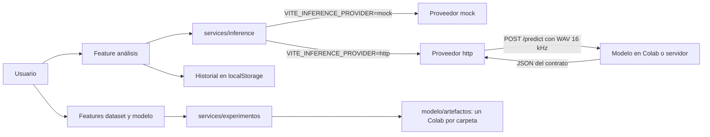

# Arquitectura

## Usuario e interfaz

`src/App.tsx` coordina las vistas y el estado general. El usuario carga o graba un audio, inicia el análisis y consulta el resultado o el historial.

## Features

Cada carpeta de `src/features/` agrupa los componentes, hooks y estilos de una funcionalidad. `analisis` maneja la captura y el resultado, `historial` guarda los análisis en `localStorage`, `dataset` y `modelo` muestran los artefactos de cada Colab, y `informacion` presenta la metodología y el equipo.

## Shared

`src/shared/` contiene lo que no pertenece a una sola funcionalidad: componentes básicos, utilidades, conversión de audio y estilos. Los colores viven solo en `tokens.css`, y `pnpm check:tokens` lo hace cumplir.

## Servicios de inferencia

`src/services/inference/index.ts` es el único punto de conexión con el modelo y elige el proveedor según el entorno. Las pantallas dependen de la interfaz `InferenceService`, así que cambiar de modelo no obliga a reescribirlas.

## Proveedores y adaptadores

`mock.ts` genera resultados simulados y deterministas. `http.ts` convierte el audio, lo envía, aplica el adaptador activo y valida la respuesta contra el [contrato](contrato-modelo.md).

## Registro de Colabs

`src/services/experimentos/` detecta cada carpeta de `modelo/artefactos/` que tenga un `experimento.json`. Un adaptador por formato traduce sus JSON y CSV a una forma común, y los archivos se cargan solo cuando se necesitan. Esta capa alimenta las pantallas de datos y es independiente de la inferencia: mostrar las métricas de un Colab no conecta sus predicciones.

## Modelo

El modelo es una CNN sobre espectrogramas Mel de 5 s (mono, 16 kHz, 96 bandas) y se entrena en Google Colab, fuera de este repositorio. El espectrograma de la interfaz es una aproximación visual de 64 bandas y no es la entrada real de la CNN.
